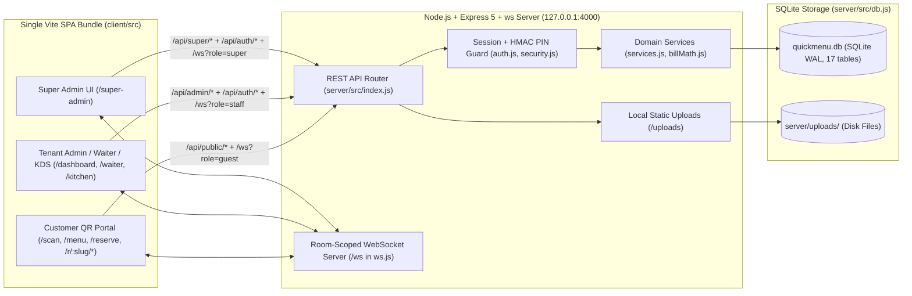
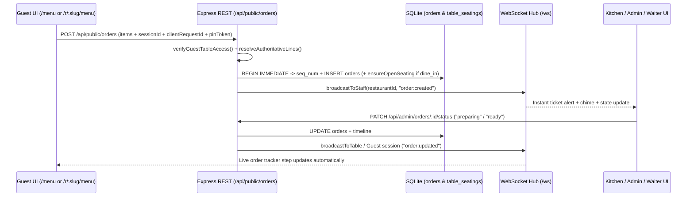

# CURRENT_ARCHITECTURE.md — Existing System Architecture

This document describes the **actual verified architecture** currently running in `c:\Arjun Projects\Quick Menu REA`.

---

## 1. High-Level Topology

Currently, the system runs as a **single-origin modular monolith** where Express 5 (`server/src/index.js`) serves API routes, uploaded media, WebSockets, and the compiled React 19 SPA (`client/dist/`).

---

## 2. Layer-by-Layer Breakdown

### Layer 1: Platform Super Admin (`/super-admin`)
- **UI Module:** `client/src/pages/SuperAdminPage.tsx` (lazy chunk).
- **Capabilities:** Platform KPIs, Venue provisioning & editing (`plan`, `plan_status`, `plan_expires_at`, `custom_domain`, `white_label`, `brand_bg`, `brand_accent`), Agency Branding modal (`platform_settings`), `Active Admins` count card + admin creation modal, Global Activity Feed, and Super Admin context impersonation (`POST /api/super/select-restaurant` updates `sessions.active_restaurant_id`).
- **Backend Guard:** `requireAuth` + `requireSuperAdmin` (`user.role === "super_admin"`).

### Layer 2: Tenant Admin, Waiter POS & Kitchen Display
- **UI Modules:** `DashboardPage.tsx` (10 tabs under `client/src/components/dashboard/`), `WaiterPage.tsx` (`/waiter`), and `KitchenPage.tsx` (`/kitchen`).
- **Session & Identity:** Uses `qm_session` HttpOnly cookie (`role = 'admin'`). Optional operator PIN lock (`ShiftModal.tsx`, `useShift.ts`) stores active waiter/cashier/kitchen identity in `localStorage` (`qserve_shift_actor_v1`) and forwards `by` metadata in write requests—without altering cookie permissions.
- **Tenant Resolution (`requireAuth` in `server/src/auth.js`):** Binds `req.restaurantId` to `user.restaurant_id` (or `session.active_restaurant_id` when `super_admin`). Every `/api/admin/*` SQL query filters by `WHERE restaurant_id = ?`.

### Layer 3: Customer QR Ordering Website
- **UI Modules:** `ScanPage.tsx`, `MenuPage.tsx`, `ReservePage.tsx`, plus modals (`DishOptionModal`, `BillModal`, `CallStaffModal`, `FeedbackModal`, `SpinWheelModal`).
- **Data Access Rule (Already Enforced):** Customer views NEVER touch `/api/admin/*` or SQLite directly; all communication happens over `/api/public/*` REST endpoints and `/ws?role=guest`.
- **Tenant Resolution (`resolvePublicRestaurant` in `server/src/index.js` & `resolveRestaurant` in `server/src/db.js`):**
  1. Explicit `restaurant` / `slug` / `r` query or JSON body param (from `/r/:slug/*` or `?restaurant=...`).
  2. Otherwise `Host` header matched against `restaurants.custom_domain`.
  3. Otherwise silently falls back to `DEFAULT_RESTAURANT_ID` (`rest_default`).
- **Security Checks:**
  - `verifyGuestTableAccess()` enforces signed HMAC `X-Table-Pin-Token` header / `pinToken` WS param when `require_table_pin = 1`.
  - `resolveAuthoritativeLines()` recalculates item prices + modifiers on the server.
  - `idempotency_key` deduplicates accidental double submissions.

---

## 3. Data Flow & State Synchronization

---

## 4. Development & Production Runtime Flow
- **Development (`npm run dev`):** `concurrently` starts `node --watch src/index.js` (`:4000`) and Vite dev server (`:5173`) proxying `/api`, `/uploads`, and `/ws` (`client/vite.config.ts`).
- **Production (`npm run build && npm start`):** Vite compiles static assets into `client/dist/`, and `server/src/index.js` serves `client/dist/` with Express static middleware + SPA fallback (`/^\/(?!api|uploads|ws).*/`).
