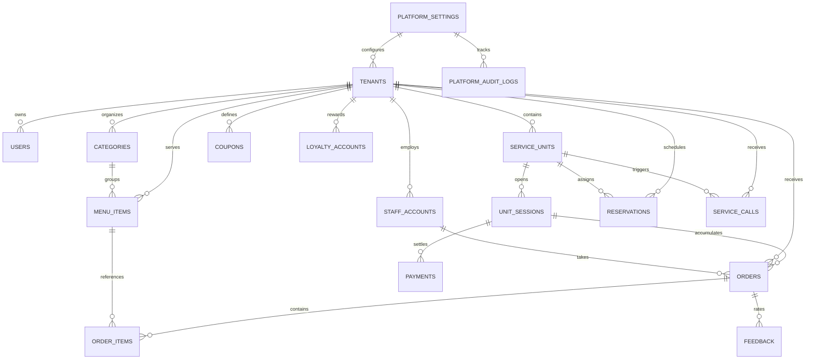

# DATABASE_DESIGN.md — Current Schema Audit & Target Multi-Tenant Design

**Current Engine:** SQLite via Node built-in `node:sqlite` (`server/data/quickmenu.db`, WAL mode, `PRAGMA foreign_keys = ON`)  
**Migration Goal:** Clean relational integrity, zero second source of truth, native Hotel Room + Restaurant Table support, and seamless SQLite -> PostgreSQL portability.

---

## 1. Current Schema Inventory & Diagnosed Defects (`server/src/db.js`)

### Existing Tables (`17` Total)
1. `platform_settings` (singleton row `id=1`: agency branding + `pin_hmac_secret`)
2. `restaurants` (multi-tenant core settings, white-label flags, JSON `table_config`, JSON `qr_style`, JSON `loyalty_config`, JSON `spin_prizes`)
3. **`restaurant_settings` (LEGACY DUPLICATE):** Legacy singleton table still created & altered in `db.js:121-133, 308-318`. **Must be retired/dropped after verification.**
4. `users` (`id`, `email`, `password_hash`, `name`, `role` [`admin` | `super_admin`], `restaurant_id`)
5. `sessions` (`token`, `user_id` FK -> `users(id)`, `active_restaurant_id`, `expires_at`)
6. `categories` (`id`, `restaurant_id`, `name`, `station`, `display_order`)
7. `menu_items` (`id`, `restaurant_id`, `category_id` FK -> `categories(id)`, `price`, JSON `size_variants`, JSON `addons`)
8. `orders` (`id`, `restaurant_id`, `order_number`, `seq_num`, `order_type`, `table_number`, `pickup_token`, customer/delivery fields, `seating_id`, **JSON `items`**, **JSON `timeline`**, `created_by_staff_id`, `idempotency_key`)
9. `table_states` (PK `(restaurant_id, table_number)`, `status`, `section`, `activated_by`)
10. `table_seatings` (`id`, `restaurant_id`, `table_number`, `status`, `table_pin`, `pin_tries`, `merged_into`, JSON `discount_json`, JSON `spin_json`, `guest_phone`, `loyalty_awarded`)
11. `payments` (`id`, `restaurant_id`, `seating_id`, `table_number`, `amount`, `tip`, `mode`, `split_type`, `status`, `handled_by`)
12. `reservations` (`id`, `restaurant_id`, `booking_code`, `customer_name`, `customer_phone`, `party_size`, `reservation_date`, `reservation_time`, `status`, `assigned_table`)
13. `service_calls` (`id`, `restaurant_id`, `table_number`, `call_type`, `status`, `acknowledged_by`)
14. `coupons` (UNIQUE `(restaurant_id, code)`)
15. `loyalty_accounts` (PK `(restaurant_id, phone)`)
16. `staff` (`id`, `restaurant_id`, `name`, `role`, **plaintext `pin`**, `section`, `active`, UNIQUE `(restaurant_id, pin)`)
17. `activity_log` (`id`, `restaurant_id`, `staff_name`, `action`, `details_json`)
18. `feedback` (`id`, `restaurant_id`, `order_id`, `seating_id`, `table_number`, `rating`, `comment`)

### Critical Current DB Defects
- **Missing Foreign Keys Across 14 Tenant Tables:** Only `sessions.user_id` and `menu_items.category_id` have SQL `REFERENCES`. Tenant cascading deletes, strict integrity on `orders.seating_id`, `payments.seating_id`, and `feedback.order_id` are unenforced at the DB layer.
- **No Hotel Unit Entity (`rooms` / `service_units`):** Only integer sequential dining tables stored inside `restaurants.table_config` JSON exist.
- **JSON `orders.items` & `orders.timeline`:** Prevents relational item-level SQL reports, station splits, partial refunds/cancellations, and modifier inventory tracking.
- **Plaintext PIN Security Risk (`staff.pin`):** Plaintext 4-digit PINs stored and queried directly in `staff`.
- **Single-Tenant vs Platform Audit Mixing:** Super Admin impersonation events land inside tenant `activity_log`.

---

## 2. Target Normalized Relational Architecture (Single Source of Truth)

---

## 3. Target Table Specifications (Additive Migration Path)

> **Backwards-Compatibility Note:** Existing `restaurants` and `table_seatings` table names can either be evolved cleanly via SQLite column additions + companion relational tables (`service_units`, `order_items`, `platform_audit_logs`) during Milestone 2–3, or aliased safely in repository helpers so zero existing queries break mid-rollout.

### Core Platform & Identity Tables
- **`platform_settings`**: Unchanged role, plus `enforce_plan_limits` flag and default currency/locale.
- **`tenants` (upgraded `restaurants`)**:
  - Retains all existing columns (`id`, `slug`, `name`, `description`, branding, tax/payment, QR styles, plan fields).
  - **Adds:**
    - `tenant_type TEXT NOT NULL DEFAULT 'restaurant'` (`'restaurant' | 'hotel' | 'resort' | 'cafe' | 'cloud_kitchen'`)
    - `currency_code TEXT NOT NULL DEFAULT 'INR'`
    - `timezone TEXT NOT NULL DEFAULT 'Asia/Kolkata'`
    - `room_service_enabled INTEGER NOT NULL DEFAULT 0`
    - `charge_to_room_enabled INTEGER NOT NULL DEFAULT 0`
    - `custom_domain_verified INTEGER NOT NULL DEFAULT 0`
- **`users`**:
  - Adds `status TEXT NOT NULL DEFAULT 'active'`, `staff_id TEXT REFERENCES staff(id) ON DELETE SET NULL`, and expands `role` (`'super_admin' | 'tenant_owner' | 'hotel_admin' | 'manager' | 'front_desk' | 'cashier' | 'waiter' | 'kitchen'`).
- **`staff` -> `staff_accounts`**:
  - Replaces plaintext `pin` responses with `pin_hash` (`scrypt`/HMAC keyed per tenant + `pin_last2` or masked label) while storing `pin_lookup_hash` (keyed SHA-256 `(tenant_id, pin)`) for instant unique lookup cleanly without exposing cleartext PINs in `GET /api/admin/staff`.
- **`platform_audit_logs`**:
  - Dedicated Super Admin audit trail (`id`, `actor_user_id`, `target_tenant_id`, `action`, `metadata_json`, `ip_address`, `created_at`).

### Unified Property Units (Hotel Rooms + Restaurant Tables)
- **`service_units` (replaces `table_config` JSON + `table_states`)**:
  - `id TEXT PRIMARY KEY`
  - `tenant_id TEXT NOT NULL REFERENCES tenants(id) ON DELETE CASCADE`
  - `unit_code TEXT NOT NULL` (e.g., `'4'`, `'101'`, `'302-A'`, `'Pool-Cabana-2'`)
  - `unit_type TEXT NOT NULL DEFAULT 'table'` (`'table' | 'room' | 'lounge' | 'cabana'`)
  - `zone_floor TEXT NOT NULL DEFAULT ''` (e.g., `'Ground Hall'`, `'3rd Floor West Wing'`)
  - `capacity INTEGER NOT NULL DEFAULT 4`
  - `qr_enabled INTEGER NOT NULL DEFAULT 1`
  - `occupancy_status TEXT NOT NULL DEFAULT 'free'` (`'free' | 'occupied' | 'bill_requested' | 'cleaning' | 'checked_in' | 'maintenance'`)
  - `sort_order INTEGER NOT NULL DEFAULT 0`
  - `UNIQUE (tenant_id, unit_code)`
  - *Single-Truth Mapping:* During transition, every active table from `table_config` is seeded into `service_units(unit_type='table')`, keeping existing `/scan?table=4` URLs 100% functional alongside `/scan?unit=101` for Hotel Rooms.

### Single Source of Truth Catalog
- **`categories`**: Adds `channel_scope TEXT NOT NULL DEFAULT 'all'` (`'all' | 'dine_in' | 'room_service' | 'takeaway_delivery'`) and foreign key `tenant_id REFERENCES tenants(id) ON DELETE CASCADE`.
- **`menu_items`**: Adds `channel_flags_json` / `available_from` / `available_until` (e.g., all-day room service vs dinner menu) referencing the exact same single `menu_items` table—never duplicating dishes across Customer UI vs Admin UI.

### Unified Sessions (Dine-In Seatings & Hotel Room Folios), Orders & Order Items
- **`unit_sessions` (evolved `table_seatings`)**:
  - Adds `unit_id TEXT REFERENCES service_units(id)`, `session_kind TEXT NOT NULL DEFAULT 'dine_in'` (`'dine_in' | 'room_stay'`), `pin_hash TEXT` / HMAC verification, `guest_name TEXT`, `checkin_ref TEXT` (optional booking/stay ref—not full PMS!).
- **`orders`**:
  - Expands `order_type`: `'dine_in' | 'room_service' | 'takeaway' | 'delivery'`.
  - Adds `unit_id TEXT REFERENCES service_units(id)`, explicit `subtotal_amount REAL`, `tax_amount REAL`, `service_charge_amount REAL`, `discount_amount REAL`, `delivery_fee REAL`, `payable_total REAL` so financial fields are uniform across all 4 order channels!
  - Enforces foreign keys: `tenant_id -> tenants(id)`, `seating_id -> unit_sessions(id)`, `created_by_staff_id -> staff(id)`.
- **`order_items` (New normalized child table replacing JSON dependency on `orders.items`)**:
  - `id`, `order_id REFERENCES orders(id) ON DELETE CASCADE`, `tenant_id REFERENCES tenants(id) ON DELETE CASCADE`, `menu_item_id REFERENCES menu_items(id) ON DELETE SET NULL`, `item_name_snapshot`, `unit_price`, `quantity`, `selected_size`, `addons_json`, `station`, `item_status`, `note`.
- **`payments`**:
  - Expands `mode` (`'upi' | 'card' | 'cash' | 'room_folio'`), links `order_id` (nullable for table/folio settlement vs direct takeaway/delivery payment) and `seating_id REFERENCES unit_sessions(id)`.

---

## 4. Essential Constraints & Indexes Checklist
- `CREATE UNIQUE INDEX idx_tenants_custom_domain ON tenants(LOWER(custom_domain)) WHERE custom_domain != ''`
- `CREATE INDEX idx_units_tenant_type_code ON service_units(tenant_id, unit_type, unit_code)`
- `CREATE INDEX idx_order_items_order ON order_items(order_id)`
- `CREATE INDEX idx_order_items_tenant_station ON order_items(tenant_id, station, item_status)`
- Keep existing indexes on `orders(tenant_id, idempotency_key)`, `orders(tenant_id, created_at DESC)`, `reservations(tenant_id, reservation_date, reservation_time)`, and `unit_sessions(tenant_id, unit_code, status)`.
