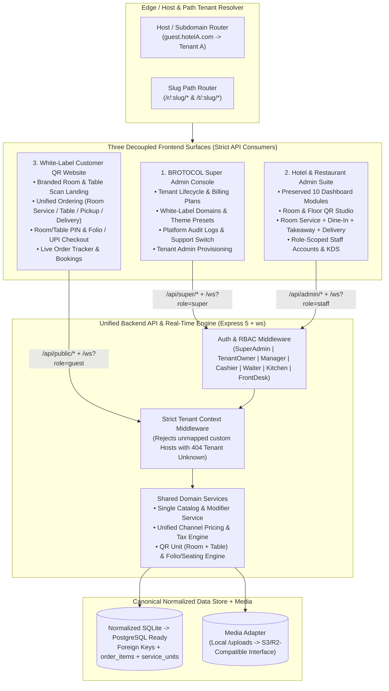

# PROPOSED_ARCHITECTURE.md — Multi-Tenant White-Label Hotel & Restaurant SaaS

This architecture upgrades **BROTOCOL ServeOS** into a clean, scalable, strictly isolated **3-Layer Multi-Tenant White-Label Hotel & Restaurant QR Ordering SaaS Platform**, preserving the existing Admin Panel (`DashboardPage` + KDS + Waiter POS) and maintaining a **single authoritative backend & database source of truth**.

---

## 1. Architectural Principles

1. **Preserve Working Admin Operations:** Extend the existing `DashboardPage`, `FloorTab`, `OrdersTab`, `MenuTab`, `QrTab`, and `KitchenPage` modules incrementally rather than rewriting them.
2. **Single Source of Truth:** All menus, categories, pricing, taxes, inventory availability, tables/rooms, orders, payments, and branding live in **one canonical backend domain**—no mirrored databases or duplicated menu tables between Customer UI and Hotel/Restaurant Admin.
3. **Strict API Boundary:** Customer QR portal (`/api/v1/public/*`), Hotel/Restaurant Admin (`/api/v1/admin/*`), and BROTOCOL Super Admin (`/api/v1/super/*`) communicate strictly via typed HTTP/WS contracts.
4. **Property-Unified Multi-Tenancy:** Every onboarded business is a Tenant (`property` / `tenant_id`) typed as `hotel`, `resort`, `restaurant`, `cafe`, or `cloud_kitchen`, supporting **Dining Tables** AND **Hotel Rooms / Suites** under unified QR and order workflows when configured.
5. **Zero-Leak White-Label Routing:** Custom domains (`order.grandhotel.com`) and tenant slugs (`/h/:slug/*`, `/r/:slug/*`) must NEVER expose sibling tenants or fallback silently to another client's menu.

---

## 2. Target 3-Layer System Architecture

---

## 3. Target Layer Responsibilities

### Layer 1: BROTOCOL Super Admin (Agency & Control Plane)
- **Responsibilities:**
  - Provision **Hotels**, **Resorts**, **Restaurants**, **Cafés**, and **Chains** (`tenant_type`, slug, custom domain, default currency/timezone/locale).
  - Manage commercial plans (`plan`, `plan_status`, `plan_expires_at`, hard/soft plan limits for rooms/tables, staff seats, custom domain eligibility).
  - Manage Agency/Reseller white-label templates (`platform_settings`) and default legal/attribution settings.
  - Provision & manage primary Tenant Admin credentials securely (`admins` management respecting configured visibility policy) and record dedicated **Platform Audit Logs** when entering tenant support mode.

### Layer 2: Hotel & Restaurant Admin (Tenant Operations Plane)
- **Preserves Existing Dashboard & Adds Hotel-Capable Extensions (When Enabled by Tenant Type/Features):**
  - **Catalog & Menu (Single Source of Truth):** Categories & dishes optionally scoped or tagged for Dining Room vs Room Service availability (e.g., all-day room service vs breakfast hours) without duplicating items.
  - **Service Units (`service_units` replacing raw `table_config` JSON):** Supports both **Tables** (`kind = 'table'`, floor section, seat capacity) and **Hotel Rooms/Suites** (`kind = 'room'`, floor/wing, guest check-in PIN or Front Desk open session).
  - **Unified Orders & Kitchen Display (`/dashboard`, `/waiter`, `/kitchen`):** Distinguishes `Room 304 (Room Service)`, `Table 4 (Dine-In)`, `Takeaway (PK-102)`, and `Delivery` on one real-time board and KDS station pipeline.
  - **Backend-Enforced Staff RBAC:** Staff accounts authenticate via short-lived staff tokens / PIN sessions mapped to backend middleware permissions (`kitchen` can update ticket states, `waiter` can punch/view orders & floor, `cashier`/`front_desk` can settle bills/folios, `manager`/`owner` can edit menu & settings).

### Layer 3: Customer QR Ordering Website (White-Label Guest Plane)
- **Strict Tenant Branding:** Loads `brand_bg`, `brand_accent`, `brand_surface`, `logo_url`, `cover_url`, favicon/title, and footer attribution dynamically from the resolved tenant—zero sibling tenant leakage on custom domains (`/api/public/venues` disabled on custom domains; `/` redirects directly to tenant storefront).
- **QR Entry Flows:**
  - **Room QR (`/t/:slug/room/304` or `?unit=R-304`):** Verifies room status + guest Room PIN/stay code if enabled, presents branded hotel menu + **Room Service** ordering + **Charge to Room Folio / UPI / Card** options + non-intrusive service requests strictly configured for hospitality (e.g., tray pickup / extra cutlery / water).
  - **Restaurant Table QR (`/scan?table=4` / `/r/:slug/scan?table=4`):** Preserves existing instant Scan -> Table PIN -> Menu -> Split Bill -> Pay flow cleanly.
  - **Off-Table Ordering:** Seamless Takeaway and Hotel/Restaurant Self-Delivery modes when enabled by tenant settings.

---

## 4. Target Backend Service & Isolation Rules

1. **Zero Silent Cross-Tenant Fallback:**
   - Custom hostname requests failing lookup in `restaurants.custom_domain` return `404 tenant_not_found` (`Unknown Branded Domain`) instead of serving `rest_default`.
   - Root `/` on a custom domain renders the tenant's Storefront/Scan landing (`white_label` view), never the BROTOCOL all-venues marketplace directory.
2. **Unified Tax, Fee & Discount Calculation (`billMath.js` Single Engine):**
   - Route Dine-In, Room Service, Takeaway, and Delivery totals through **one server pricing & tax calculator** supporting itemized food total, packaging/delivery fee (if applicable), GST %, service charge %, and valid promo coupons consistently.
3. **Horizontal Deployment Path (Optional SaaS Scale Phase):**
   - Abstract DB access behind a slim repository layer (`node:sqlite` for self-contained single-node setups; PostgreSQL adapter ready for cloud SaaS).
   - Abstract file storage (`/uploads` local vs object storage) and WebSocket pub/sub (`ws` in-memory vs Redis pub/sub) behind clean interfaces so single-box BROTOCOL ServeOS works identically offline while ready for multi-instance cloud hosting.
